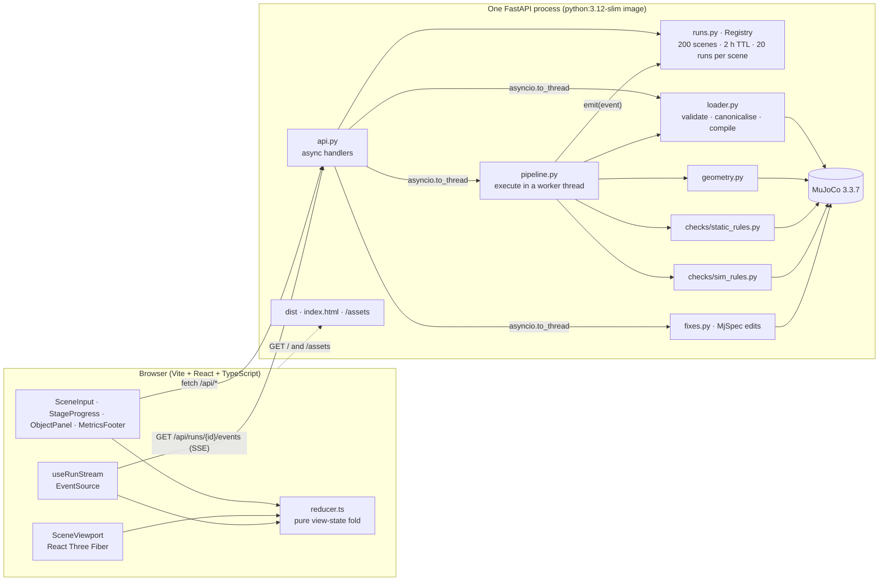
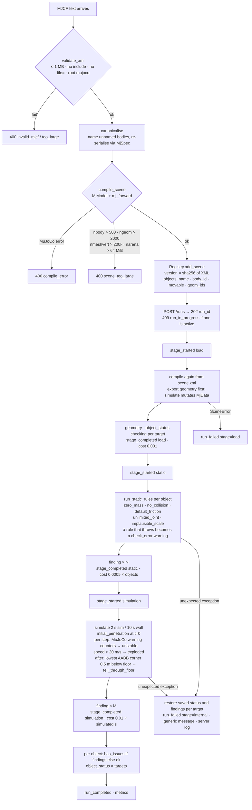
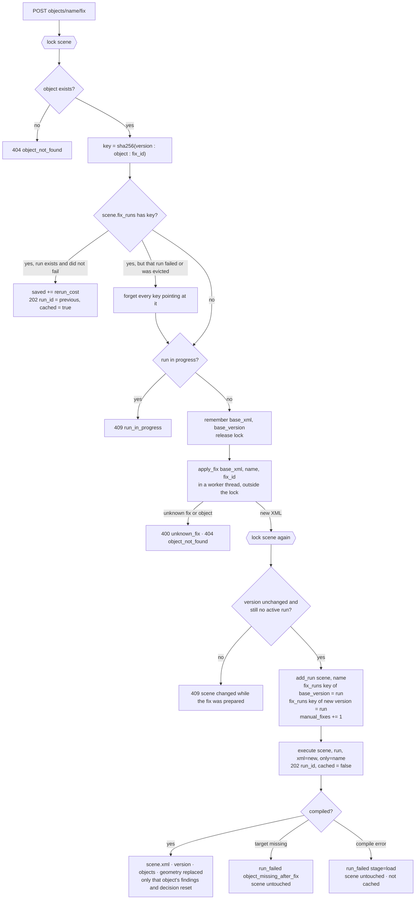
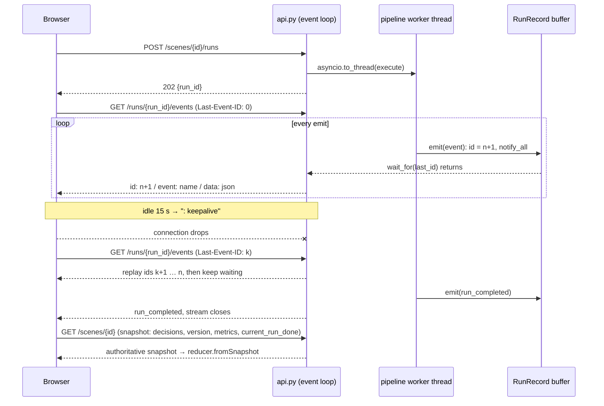
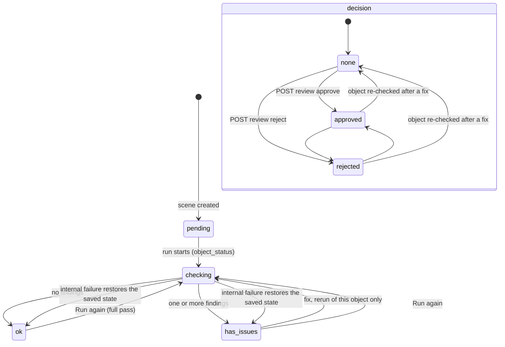
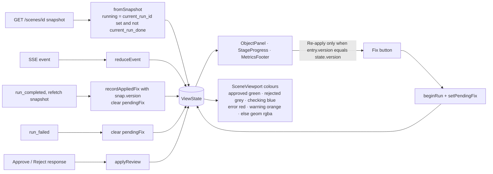

# Architecture and flows

Diagrams for the paths a scene takes through Sim-Scene Review. They render on
GitHub (Mermaid); the prose version of the same decisions is in the
[README](../README.md) and the [design spec](specs/2026-10-15-sim-scene-review-design.md).

## 1. Components

Everything the browser draws comes from the compiled `MjModel`
(`geometry.py`), so the viewport shows exactly what the simulation stage
checks.

## 2. A review run

`POST /api/scenes` (sample) or `POST /api/scenes/upload` creates a scene;
`POST /api/scenes/{id}/runs` starts a full run. The pipeline runs in a worker
thread and writes events into the run's buffer; the browser reads them over
SSE (section 4).

## 3. Fix, rerun and idempotency

`POST /api/scenes/{id}/objects/{name}/fix {fix_id}`. A fix edits the scene
through `MjSpec`, the result is compiled fresh, and only that object is
re-checked (`only=name`). The same fix on the same version is answered from
the cache without compute.

The four fixes:

| fix_id | MjSpec edit | Offered by |
| -- | -- | -- |
| `recompute_mass` | clear explicit inertia, density 1000, mass unset | `zero_mass` |
| `enable_collision` | contype = conaffinity = 1 on every geom | `no_collision` |
| `limit_joints` | hinge ±90°, slide ±0.5 m on joints without a range | `unlimited_joint` |
| `scale_mm_to_m` | geom size and pos × 0.001 | `implausible_scale` (only when ÷1000 lands in range) |

## 4. Streaming a run to the browser

Each run keeps its events in memory with increasing ids. The server replays
from `Last-Event-ID` and then blocks in `Condition.wait_for` on a worker
thread; the browser's `EventSource` reconnects on its own.

Events the browser folds: `stage_started`, `stage_completed`, `geometry`,
`object_status`, `finding`, `run_completed`, `run_failed`.

## 5. Object lifecycle

`status` and `decision` are independent fields on `ObjectState`. The scene
is marked usable the first time every object is `approved`; that moment is
the **time to usable scene** metric.

## 6. Frontend state

All reducer functions are pure and unit-tested (`frontend/src/reducer.test.ts`).
